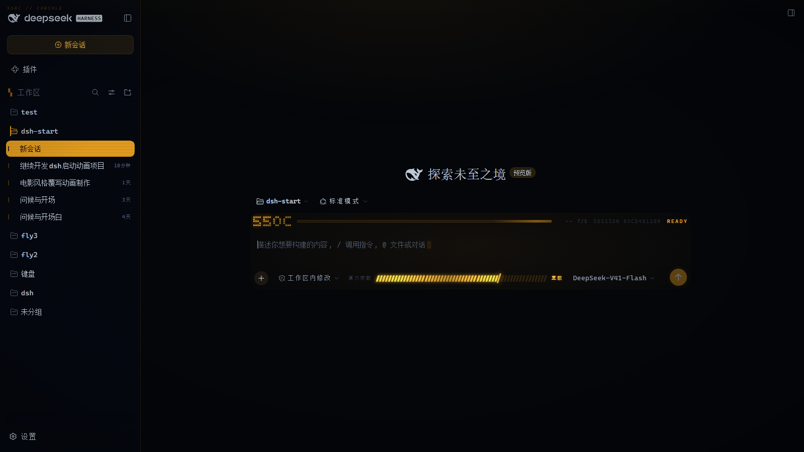
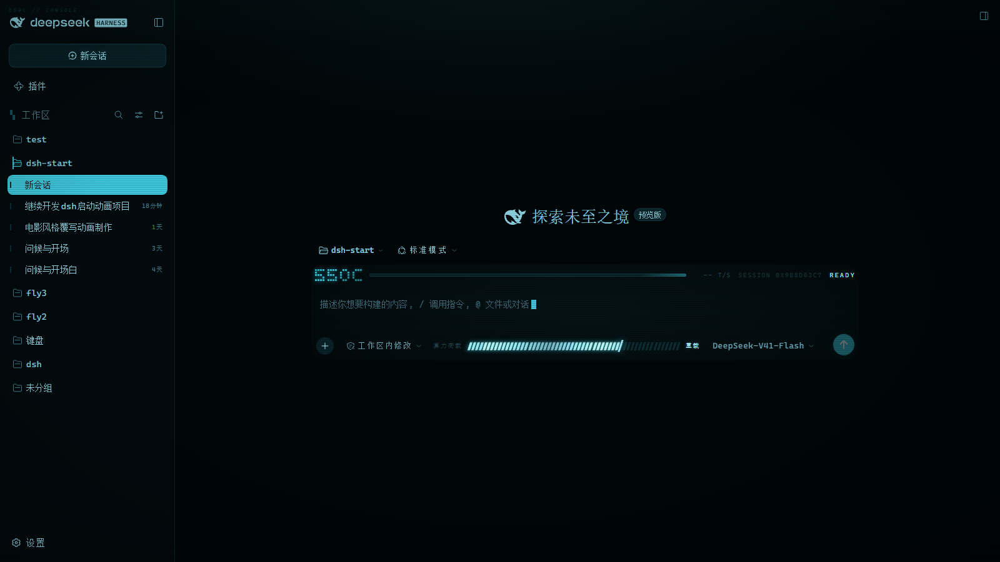

# dsh-550c-skin

[中文](README.md) | [English](README.en.md)

[](https://www.npmjs.com/package/dsh-550c-skin)
[](https://www.npmjs.com/package/dsh-550c-skin)
[](https://www.npmjs.com/package/dsh-550c-skin)
[](https://github.com/yannicksong0106/dsh-550c-skin/stargazers)
[](https://github.com/yannicksong0106/dsh-550c-skin/forks)
[](https://github.com/yannicksong0106/dsh-550c-skin/commits/master)
[](LICENSE)

**Repaints the whole DeepSeek Harness shell as a 550C console.**

Four phosphor schemes, a scan line, a vignette, monospace type and readout rails - the same look as the `dsh-550c-boot` intro.





---

## Features

### 🎨 Four phosphor schemes

| Scheme | Feel |
| --- | --- |
| **Amber** | Default. An old CRT terminal, warm phosphor. |
| **Green** | The classic monochrome monitor. |
| **Cyan** | Cooler, closer to a modern console. |
| **White** | Clean and restrained - good in daylight. |

There is also **off**, which puts DSH's own look back.

### 📺 Screen treatment

- **Scan line**: a very faint horizontal banding, can be turned off
- **Vignette**: corners darkened so the middle draws the eye
- **Monospace**: readouts, serials and code all line up
- **Readout rails**: numbers in the shell are rewritten in console style

### ⚙️ Settings

Under **Settings → 550C → 外观 (Look)**:

- Pick a scheme, adjust the scan line and vignette, toggle monospace and the panel treatment
- **Applies live**, no restart
- **Remembers your choice**: the host half writes a state file and the client keeps a localStorage fallback

### 🔄 Update check

A **version** row in the settings page: it shows what you have, asks npm whether something newer exists, and can update in one click (on the desktop client it points you to Settings → Plugins instead).

### 🎬 Companion intro

The same suite ships a boot intro plugin:

> **[dsh-550c-boot](https://www.npmjs.com/package/dsh-550c-boot)** - the 550C boot animation, followed by an interactive UEG access-permission sequence.

The two plugins **install independently and have no code dependency**; when both are present, the 550C settings page is owned by boot and the skin only adds its own rows to it.

---

## Install

```bash
npm i dsh-550c-skin
```

Or inside DSH: **Settings → Plugins → install** `dsh-550c-skin@latest`, then restart the client.

---

## Usage

```
Settings → 550C → 外观 (Look)
  scheme     amber / green / cyan / white / off
  scan line  on / off
  vignette   on / off
  monospace  on / off
  panels     full / sidebar / grid / off
  version    installed version · check for updates
```

---

## Known limitations

- **No self-update on the desktop client** (the desktop profile is managed exclusively by the app) - the update check points you to Settings → Plugins
- This is a **beta** (`0.1.0-beta.1`); scheme details will still be adjusted

---

## License and credits

MIT © [Ziyang Song](https://github.com/yannicksong0106)

The colour scheme originated in **[Voidpocket](https://github.com/Voidpocket)**'s 550C intro animation; the skin plugin is by **Ziyang Song**. See [CREDITS.md](CREDITS.md).
